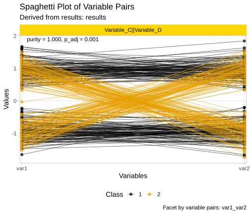
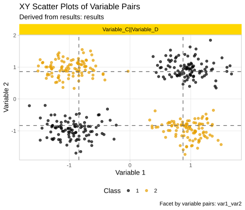

# detectXOR: XOR pattern detection and visualization in R

Provides tools for detecting XOR-like patterns in variable pairs. Includes visualizations for pattern exploration.

## Overview

Traditional feature selection methods often miss complex non-linear relationships where variables interact to produce class differences. The `detectXOR` package specifically targets **XOR patterns** - relationships where class discrimination only emerges through variable interactions, not individual variables alone.

### Key capabilities

🔍 **XOR pattern detection** - XOR purity of a 3×3 tile partition, calibrated by class-label permutations with multiple-testing control  
📈 **Correlation analysis** - Class-wise Kendall τ coefficients  
📊 **Visualization** - Spaghetti plots and decision boundary visualizations  
⚡ **Parallel processing** - Multi-core acceleration for large datasets  
🔬 **Robust statistics** - Winsorization and scaling options for outlier handling  
🎯 **Specificity** - Distinguishes XOR patterns from other interactions (e.g., AND) and from main effects  

### What is new in version 0.2.0
The decision rule was revised: XOR patterns are now identified by the XOR purity with a permutation test and
multiple-testing control, a confidence-bound criterion for the strength of the pattern, and a completeness
criterion, replacing the chi-square comparison of version 0.1.0. Several bugs were fixed (e.g., detection no
longer depends on class coding, and class columns can have any name). See [NEWS.md](NEWS.md) for details.

## Installation

The R library can be found on The Comprehensive R Archive Network at
https://cran.r-project.org/package=detectXOR


Install the library from CRAN:
```r
# Install detectXOR
install.packages("detectXOR")
```

Version 0.2.0 can also be installed from GitHub (release tag `v0.2.0`):
```r
# install.packages("remotes")
remotes::install_github("JornLotsch/detectXOR@v0.2.0")
```
### Dependencies
The package requires R ≥ 3.5.0 and depends on:
- `dplyr`, `tibble` (data manipulation)
- `ggplot2`, `ggh4x`, `ggthemes` (visualization)
- `reshape2`, `glue` (data processing and string manipulation)
- `DescTools` (winsorization)
- `knitr`, `kableExtra`, `htmltools`, `base64enc` (HTML report)
- Base R packages: `stats`, `utils`, `methods`, `grDevices`

Optional packages (suggested):
- `pbmcapply` (Unix) or `future`, `future.apply` (Windows) for parallel processing
- `testthat`, `rmarkdown` (development and documentation)


## Quick start
### Basic XOR detection
```r
library(detectXOR)
# Load example data
data(XOR_data)
# Detect XOR patterns with default settings
set.seed(42)  # permutation p-values are reproducible with a fixed seed
results <- detect_xor(XOR_data, class_col = "class")
# View summary
print(results$results_df)
```
### Usage with custom parameters
```r
# Detection with custom thresholds and parallel processing
results <- detect_xor(
  data = XOR_data,
  class_col = "class",
  p_threshold = 0.01,
  tau_threshold = 0.4,
  purity_threshold = 0.9,
  n_perm = 9999,
  max_cores = 4,
  extreme_handling = "winsorize",
  scale_data = TRUE
)
```

## Function parameters
### `detect_xor()` - Main detection function

| Parameter | Type | Default | Description |
| --- | --- | --- | --- |
| `data` | data.frame | _required_ | Input dataset with variables and class column |
| `class_col` | character | `"class"` | Name of the class/target variable column |
| `check_tau` | logical | `TRUE` | Require opposite class-wise Kendall τ correlations |
| `compute_axes_parallel_significance` | logical | `FALSE` | Require all four group-wise Wilcoxon tests to be significant (continuous variables only) |
| `p_threshold` | numeric | `0.05` | Significance level for the adjusted permutation p-value, the purity confidence bound and the Wilcoxon tests |
| `tau_threshold` | numeric | `0.3` | Minimum absolute class-wise τ |
| `purity_threshold` | numeric | `0.8` | Minimum XOR purity that the one-sided lower confidence bound must reach |
| `min_tile_share` | numeric | `0.05` | Minimum share of a class' critical-tile points in each of its two expected tiles |
| `n_perm` | integer | `999` | Number of class-label permutations |
| `p_adjust_method` | character | `"maxT"` | Multiple-testing adjustment across pairs: `"maxT"` (Westfall-Young, FWER) or any `p.adjust` method, e.g. `"BH"` |
| `split_method` | character | `"quantile"` | Tile splitting method: `"quantile"` or `"range"` (equal-width thirds) |
| `split_quantiles` | numeric vector | `c(1/3, 2/3)` | Quantiles of the tile boundaries for `split_method = "quantile"` |
| `max_cores` | integer | `1` | Maximum cores for parallel processing |
| `extreme_handling` | character | `"winsorize"` | Outlier handling: `"winsorize"`, `"trim"` (synonym `"remove"`), or `"none"` |
| `winsor_limits` | numeric vector | `c(0.05, 0.95)` | Winsorization or trimming quantiles |
| `scale_data` | logical | `TRUE` | Standardize variables before analysis |
| `use_complete` | logical | `TRUE` | Use only complete cases (remove NA values) |
| `balance_classes` | logical | `FALSE` | Down-sample the larger class to the size of the smaller class (recommended for marked class imbalance) |

`abs_diff_threshold` of version 0.1.0 is deprecated and ignored.

## Output structure
The `detect_xor()` function returns a list with three components:
### `results_df` - Summary data frame

| Column | Description |
| --- | --- |
| `var1`, `var2` | Variable pair names |
| `xor_shape_detected` | Logical: XOR pattern identified (all criteria met) |
| `xor_pattern` | `"default"`, `"rotated"`, or `"none"` |
| `candidate_pattern` | Manifestation with the higher XOR purity |
| `xor_purity` | XOR purity (0.5 = no XOR structure, 1 = perfect XOR) |
| `purity_lower` | One-sided lower confidence bound of the purity |
| `coverage_ok` | Logical: each class populates both of its expected tiles |
| `p_value`, `p_adjusted` | Permutation p-value and its multiplicity-adjusted value |
| `tau_class1`, `tau_class2` | Class-wise Kendall τ (with p-values), computed for pairs meeting the tile criteria |
| `is_strong_reverse_correlated` | Logical: τ criterion met |
| `axis_tests_passed` | Logical: group-wise Wilcoxon criterion met (NA if not computed or binary) |
| `interpretation` | Text summary including unmet criteria |

### `pair_list` - Detailed results
Contains the analysis for each variable pair, including the observed tile table,
tile shares, class-wise τ, and the Wilcoxon test results.

### `settings` - Parameter values used

## Visualization functions

| Function | Description | Key Parameters |
| --- | --- | --- |
| `generate_spaghetti_plot_from_results()` | Creates connected line plots showing variable trajectories for XOR-detected pairs | `results`, `data`, `class_col`, `scale_data = TRUE` |
| `generate_xy_plot_from_results()` | Generates scatter plots with decision boundary lines for detected XOR patterns | `results`, `data`, `class_col`, `scale_data = TRUE`, `quantile_lines = c(1/3, 2/3)`, `line_method = "quantile"` |

Both functions return ggplot objects that can be displayed or saved manually.

``` r
# Generate plots
generate_spaghetti_plot_from_results(results, XOR_data, class_col = "class")
generate_xy_plot_from_results(results, XOR_data, class_col = "class")
```

Facet headers show the XOR purity and the adjusted p-value of each detected pair; their shading reflects the purity.

### Example plots 






## Reporting functions

| Function | Description | Key Parameters |
| --- | --- | --- |
| `generate_xor_reportConsole()` | Creates console-friendly formatted report with optional plots | `results`, `data`, `class_col`, `scale_data = TRUE`, `show_plots = TRUE` |
| `generate_xor_reportHTML()` | Generates comprehensive HTML report with interactive elements | `results`, `data`, `class_col`, `output_file`, `open_browser = TRUE` |

### Example report

```r
# Generate formatted report 
generate_xor_reportHTML(results, XOR_data, class_col = "class")
```

The report will be automatically opened in the system standard web browser.


## Methodology
### XOR detection pipeline
1. **Pairwise dataset creation** - Extract all variable pairs with preprocessing
2. **Tile partition** - Divide each variable pair's plane into 3×3 tiles at the tertiles. The four corner tiles define the default XOR manifestation, the four edge-center tiles the rotated (45°) manifestation
3. **XOR purity** - Balanced accuracy of the XOR rule among the observations in the critical tiles, maximized over both class-label assignments and both manifestations
4. **Permutation test** - Class labels are permuted (shared permutations across all pairs) to obtain p-values, adjusted for the number of pairs by the Westfall-Young max-T procedure
5. **Strength and completeness** - The lower confidence bound of the purity must reach `purity_threshold`, and each class must populate both of its expected tiles
6. **Correlation analysis** - Class-wise Kendall τ must be of opposite sign and sufficient magnitude
7. **Optional axis tests** - Group-wise Wilcoxon tests along the tile axes

### Statistical tests
- **Permutation test**: Tests whether the XOR purity exceeds what is expected without association between the variable pair and the class
- **Kendall τ**: Measures monotonic correlation within each class separately
- **Wilcoxon rank sum** (optional): Evaluates group differences along variable axes

## Use cases
### Machine learning
- **Feature selection enhancement** - Identify interaction features that complement traditional univariate methods
- **Variable interaction discovery** - Find synergistic variable pairs where class separation emerges only through combined effects
- **Preprocessing for ensemble methods** - Generate interaction features for boosting algorithms and neural networks
- **Dimensionality reduction guidance** - Preserve important variable interactions when reducing feature space

## Technical details
### Cross-platform compatibility
- **Windows**: Uses `future::multisession` for parallel processing
- **Unix/Linux/macOS**: Uses `pbmcapply::pbmclapply` with fork-based parallelism
- **Memory management**: Automatic chunk-based processing for large datasets

### Package structure
```r
detectXOR/
├── R/                 # Package source code
├── man/               # Package documentation
├── data/              # Example dataset
├── tests/             # Unit tests (testthat)
├── issues/            # Problem reporting
├── analyses/          # Scripts reproducing the analyses of the publication (not part of the package)
└── NEWS.md            # Changes between versions
```

## Reproducing the analyses of the publication
The folder [`analyses`](analyses) contains the R scripts that generate all data sets, tables and figures
of the publication, including the simulation study, the sensitivity analysis, the comparison with other
interaction-detection methods, the machine-learning benchmark, and the real-data analyses. All analyses
were performed with the release tagged `v0.2.0`. See [analyses/README.md](analyses/README.md) for the order
of execution and the outputs.

## License

This project is licensed under the GNU General Public License v3.0 (GPL-3.0)

## Citation

Lötsch, J, Kringel D & Ultsch A. Generalized XOR patterns reveal accurate predictors without statistical significance. [in revision]